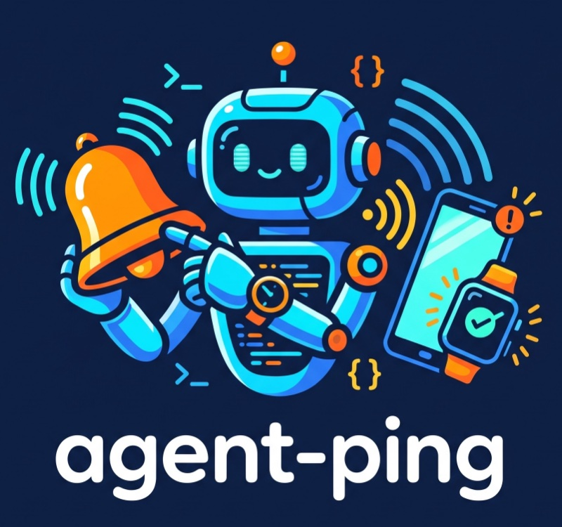

<p align="center"></p>

<p align="center"><b>Your phone and watch buzz when your AI agent is done — or needs you.</b></p>

<p align="center">
Claude Code · Codex · Cursor · Gemini CLI · Hermes<br>
in the terminal, the desktop apps or VS Code · macOS · Linux · Windows · WSL
</p>

<p align="center"><a href="README.zh-CN.md">中文说明</a></p>

---

You've got three agents working in parallel. Or you've stepped away from your desk for a coffee.
You don't want to keep checking the screen. You just want a tap on the wrist when one of them
**finishes**, or **stops to ask you something** — without wiring up a chat bot, a server or yet another account.

**agent-ping is that tap.** One small binary, one install command, and your phone buzzes when:

- ✅ **an agent finishes** — with the project name and how long it took
- ⏳ **it needs your OK** to run a command
- ❓ **it's asking you a question** and waiting for an answer

No bot, no server, no sign-up with the default (free) ntfy app. Nothing to install on the watch —
Apple Watch and most fitness bands mirror your phone. And nothing of your code or chat leaves the
machine: a ping only says which agent, which folder, and how long.

```sh
curl -fsSL https://raw.githubusercontent.com/gaoxin492/agent-ping/main/install.sh | sh
```

**Contents:** [Install](#install) · [Several computers](#several-computers-one-phone) · [Phone apps](#phone-apps) · [Agents](#agents) · [Settings](#settings) · [Not getting pings?](#not-getting-pings) · [Uninstall](#uninstall) · [Privacy](#privacy)

## Install

macOS / Linux:

```sh
curl -fsSL https://raw.githubusercontent.com/gaoxin492/agent-ping/main/install.sh | sh
```

Windows (PowerShell):

```powershell
irm https://raw.githubusercontent.com/gaoxin492/agent-ping/main/install.ps1 | iex
```

The setup asks which phone app to use, sends a test, then hooks up every agent it finds.
Restart open agent sessions afterwards.

## Several computers, one phone

Install agent-ping on each computer and give them all **the same topic** (ntfy) or **the same key** (Bark). Your phone subscribes once.

1. On a computer that's already set up, look up the topic:
   ```sh
   agent-ping status        # channel: ntfy https://ntfy.sh/YOUR-TOPIC
   ```
2. On the new computer, run the installer. When it asks for the topic, **don't just press Enter** — paste that topic.
   Already installed? Switch it:
   ```sh
   agent-ping use ntfy YOUR-TOPIC
   agent-ping use bark https://api.day.app/YOURKEY   # if you use Bark
   agent-ping test
   ```

Each notification names the project folder; give each computer a name with `agent-ping set machine <name>` and you can tell which machine and which project finished.

### Windows + WSL

agent-ping only sees agents running **on the same side** it's installed on:

| Your agent runs in… | Install in… | Command |
|---|---|---|
| a WSL terminal (Ubuntu etc.) | WSL | `curl -fsSL https://raw.githubusercontent.com/gaoxin492/agent-ping/main/install.sh \| sh` |
| Windows itself (PowerShell, Cursor, Claude desktop) | PowerShell | `irm https://raw.githubusercontent.com/gaoxin492/agent-ping/main/install.ps1 \| iex` |

Use both? **Install on both** — each side keeps its own config. Give both the same topic as above and they reach the same phone.

- WSL usually can't read keyboard idle time, so the `idle` setting has no effect there: every finished task pings.
- Agents in WSL keep their config in the Linux home (e.g. `~/.claude`), separate from Windows' `C:\Users\you\.claude`.

## Phone apps

| App | Phones | Notes |
|---|---|---|
| ntfy (default) | iPhone, Android | Free, no account. Subscribe to the topic setup shows you. |
| Bark | iPhone | Paste the URL the app shows. |
| Pushover | iPhone, Android | One-time purchase. |
| Telegram | any | Via your own bot. |
| Webhook | — | Slack, Discord, Feishu, or your own server. |

Switch anytime: `agent-ping use bark https://api.day.app/YOURKEY`

## Agents

Three kinds of ping: **✅ finished**, **⏳ needs your OK** (approve a command or permission), **❓ asking you something** (pick an option or answer).

| Agent | ✅ Finished | ⏳ Needs your OK | ❓ Asking you |
|---|---|---|---|
| Claude Code | ✅ | ✅ | ✅ multiple-choice questions (AskUserQuestion), MCP forms |
| Codex | ✅ | see note below | request_user_input (wired up, not yet tested) |
| Cursor ¹ | ✅ (incl. errors) | — | — |
| Gemini CLI ¹ | ✅ | ✅ | — |
| Hermes | ✅ | ✅ | ✅ clarify questions |
| Anything else | `agent-ping run -- <command>` pings when the command ends | | |

¹ Hooked up from their documented hook formats and covered by unit tests, but not yet tried on a real install — reports welcome.

**Works wherever you run them.** The same hooks cover all of these, each tested on a real machine:
Claude Code / Codex / Hermes in a terminal, the **Claude desktop app**, the **Claude Code extension for VS Code**, the **Codex extension for VS Code**, and **Codex in the ChatGPT desktop app** — on macOS, Windows and WSL.
Web chat (claude.ai, chatgpt.com) and plain ChatGPT chat expose no hooks, so they can't ping.

**Codex note:** "finished" comes from Codex's `notify`, which every version and app calls.
Start time, approvals and questions use Codex's newer hooks (`~/.codex/hooks.json`). Codex only runs hooks you've trusted; agent-ping writes that trust record when it installs, so there's nothing to click in `/hooks`.
"Needs your OK" relies on Codex calling `PermissionRequest` before it asks you: on Codex 0.162 (alpha) it doesn't fire yet, and it will start working once Codex does.
The trust record follows Codex's own hashing; if a future Codex changes it, those extra hooks go quiet (Codex shows them as untrusted in `/hooks`) while "finished" pings keep working. Re-running the installer, or trusting them in `/hooks`, fixes it.

**Hermes note:** only the default profile (`~/.hermes`) is hooked — other `hermes profile`s stay quiet — and gateway (Telegram etc.), cron and subagent turns are skipped.

`agent-ping install claude` hooks just one agent. `agent-ping status` shows what's hooked.

### Turn an agent's pings on or off

```sh
agent-ping off codex           # mute Codex
agent-ping on claude hermes    # unmute Claude Code and Hermes (hooks them if they aren't yet)
agent-ping off                 # pause everything
agent-ping on                  # resume everything
agent-ping status              # see what's on / off
```

`off` only tells agent-ping to stay quiet — the hooks stay — so it takes effect at once, no agent restart.

## Settings

```sh
agent-ping set min_seconds 30     # skip quick tasks
agent-ping set idle 60            # stay quiet while you're at the keyboard
agent-ping set include_text true  # add the start of the agent's reply
agent-ping set approval false     # no pings for permission requests or questions
agent-ping set machine "Work PC"  # name this computer in every ping ("-" to clear)
agent-ping set lang zh            # 中文通知 (setup asks for the language first)
```

"Project" in a ping is the folder the agent ran in: `~/code/my-app` shows as "Project: my-app".

## Not getting pings?

- **You're at the computer.** If you answered "yes" to *stay quiet while you're using the computer*, nothing comes while you type. Turn it off: `agent-ping set idle 0`.
- **The watch stays still but the phone buzzes.** That's iOS: notifications go to the watch only while the iPhone is locked. Also check the Watch app → Notifications → your push app is set to *Mirror my iPhone*.
- **Nothing at all.** Run `agent-ping test`. If that arrives, restart the agent session you're in (hooks load at start), then check `agent-ping status` that the agent is listed under *on*.
- **ntfy on iPhone feels late.** Bark uses Apple's push directly and is usually more reliable on iOS: `agent-ping use bark https://api.day.app/YOURKEY`.

## Uninstall

```sh
agent-ping uninstall
```

Your original agent config files are backed up next to them as `*.agent-ping.bak`.

## Privacy

Notifications contain the agent name, project folder name and run time. The agent's reply text is **off** by default.
The default ntfy server is public: anyone who knows your topic name can read it, so keep the random name setup picks
(or self-host ntfy).
